# AutoVitrine

Marketplace de carros **novos e usados**: qualquer pessoa se cadastra, anuncia com fotos e já vê quanto a **tabela FIPE** paga pelo veículo. Quem compra navega como numa loja, com busca e filtros.

> **Status:** protótipo de interface (somente front-end). Não há banco de dados nem servidor próprio: os anúncios de exemplo são fictícios e tudo que o usuário cadastra fica no `localStorage` do navegador.

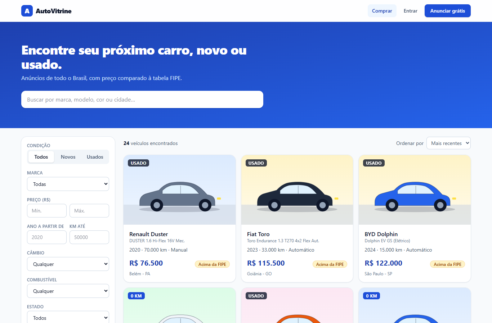

## Sumário
- [Funcionalidades](#funcionalidades)
- [Telas](#telas)
- [Como rodar](#como-rodar)
- [Integração com a tabela FIPE](#integração-com-a-tabela-fipe)
- [Estrutura do projeto](#estrutura-do-projeto)
- [Regras de negócio](#regras-de-negócio)
- [Testes](#testes)
- [Limitações conhecidas](#limitações-conhecidas)
- [Próximos passos](#próximos-passos)

## Funcionalidades
- **Loja** com 24 anúncios de exemplo, busca por texto (marca, modelo, cor, cidade; ignora acentos e maiúsculas), filtros e ordenação.
- **Filtros:** condição (novo/usado), marca, faixa de preço, ano mínimo, km máximo, câmbio, combustível e estado.
- **Ordenação:** mais recentes, menor preço, maior preço, menor km, mais novos.
- **Selo FIPE** em cada anúncio: *abaixo*, *na média* ou *acima* da tabela.
- **Página do anúncio:** galeria de fotos, ficha técnica, opcionais, descrição, comparação com a FIPE e contato do vendedor (WhatsApp e telefone).
- **Cadastro e login** simples (demonstração).
- **Anunciar em 4 passos** com consulta FIPE ao vivo e indicador de preço em tempo real.
- **Fotos:** arrastar e soltar, até 10 por anúncio, escolher a capa, remover; as imagens são reduzidas (máx. 1000 px) antes de salvar.
- **Meus anúncios:** listar, pausar/reativar e excluir.
- **Responsivo** (mobile primeiro) e em português do Brasil.

## Telas

### Loja e filtros
Filtros aplicados (usados, Volkswagen, câmbio automático):

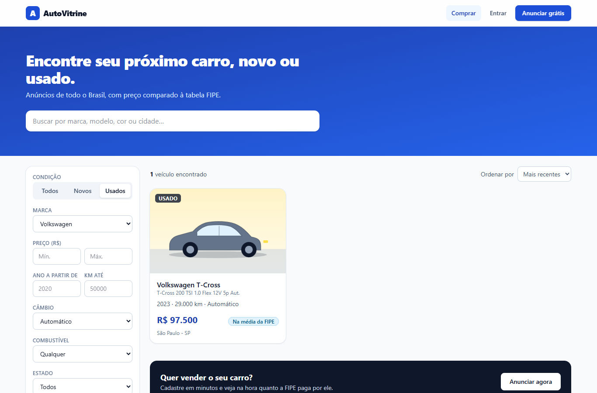

### Página do anúncio
Galeria, ficha técnica, comparação com a FIPE e contato do vendedor:

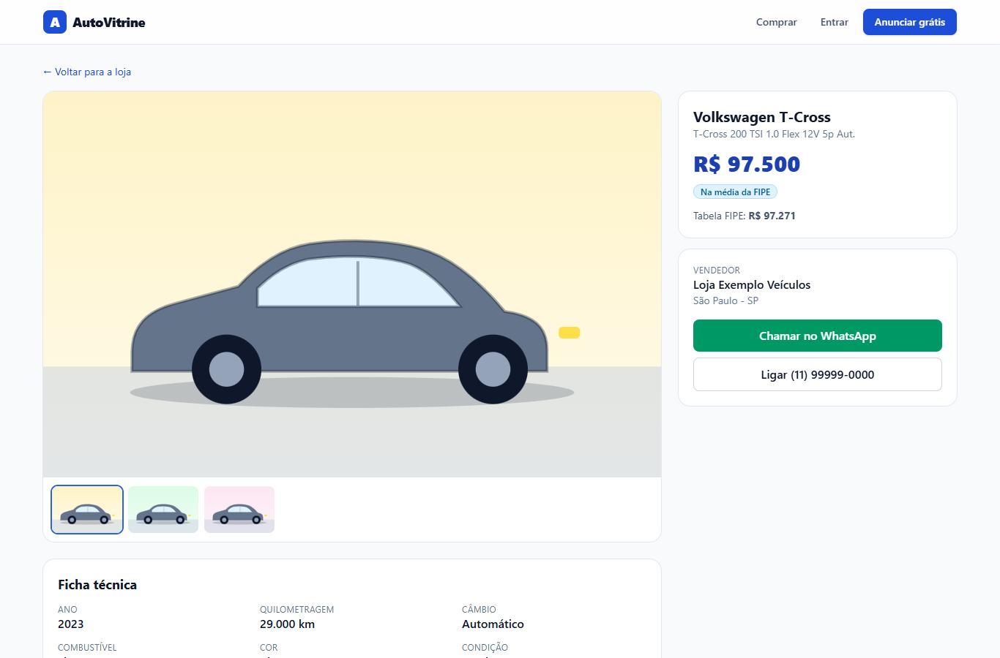

### Cadastro
Para anunciar é preciso estar logado. Quem tenta acessar `/anunciar` é levado ao cadastro e volta depois:

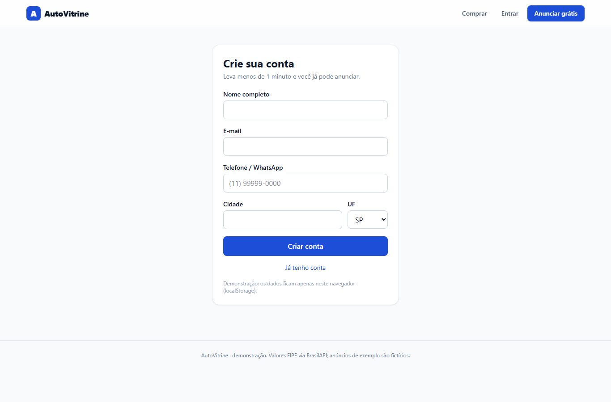

### Anunciar em 4 passos

**1. Veículo** — novo ou usado, marca, modelo (com filtro de texto), ano e, opcionalmente, o código FIPE. O valor da tabela aparece na hora:

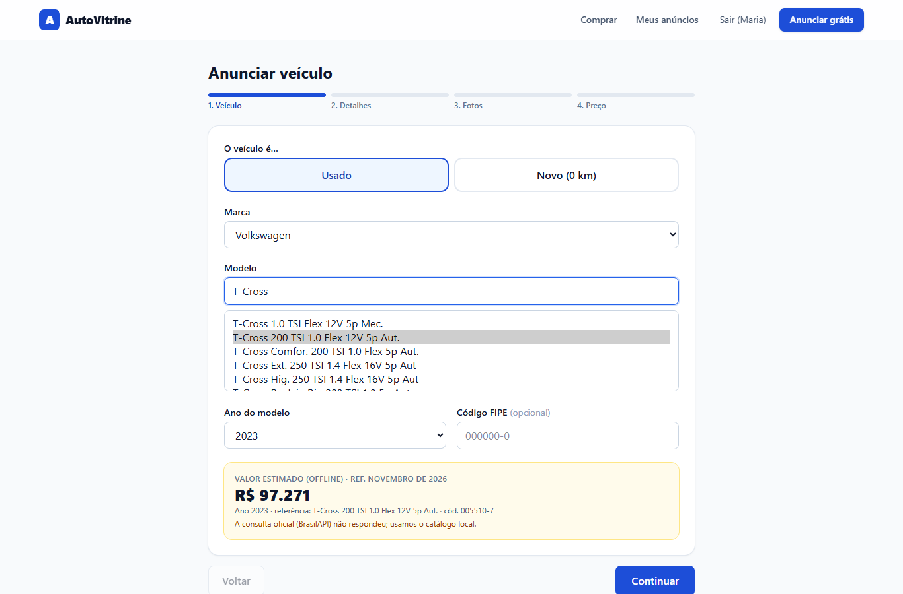

**2. Detalhes** — km, cor, câmbio, combustível, cidade/UF, opcionais e descrição:

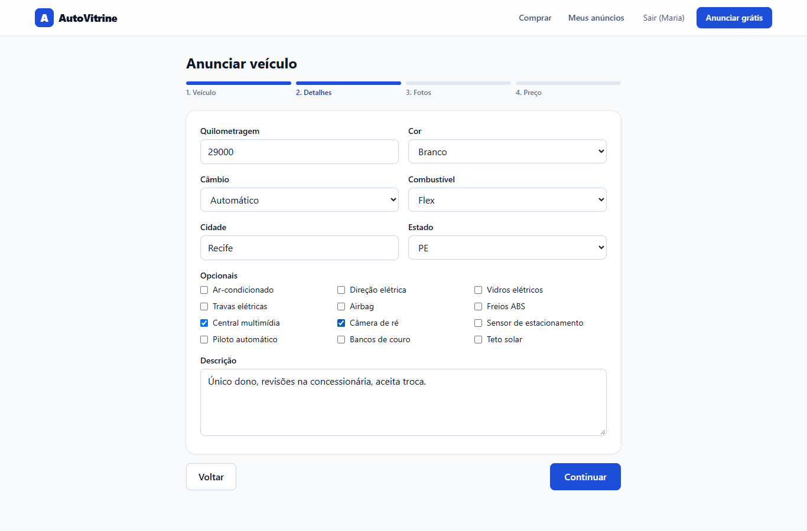

**3. Fotos** — arraste ou escolha os arquivos; a primeira é a capa:

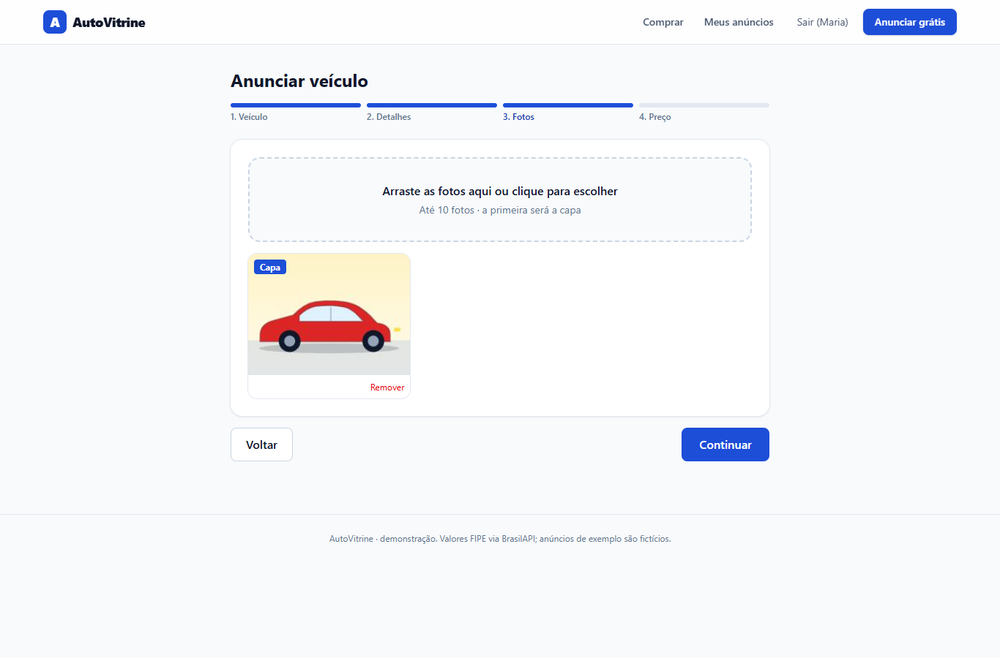

**4. Preço** — ao digitar o valor, o selo mostra se está abaixo, na média ou acima da FIPE (com a diferença em % e R$), mais um resumo antes de publicar:

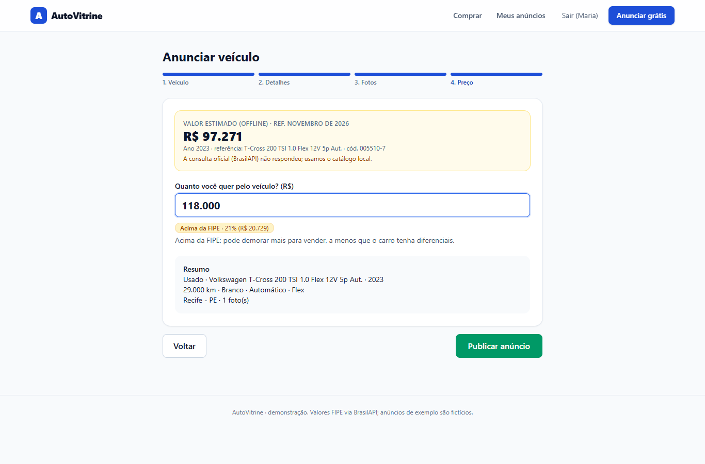

### Meus anúncios

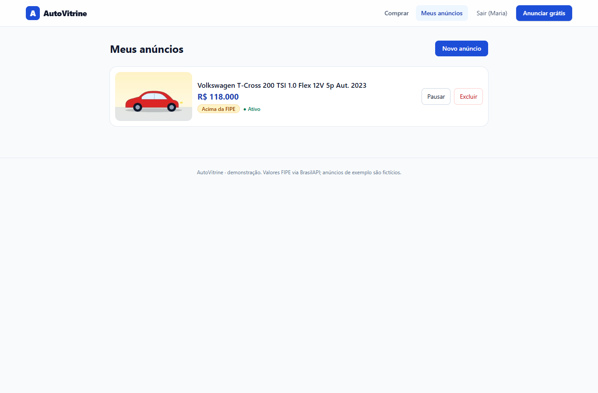

### Versão mobile

<p>
  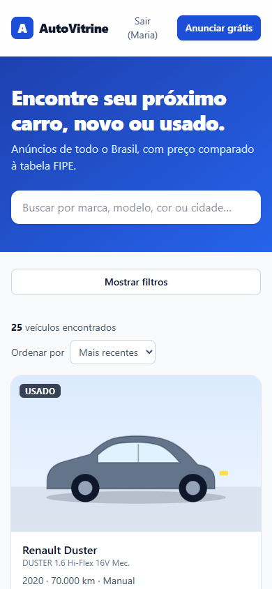
  &nbsp;
  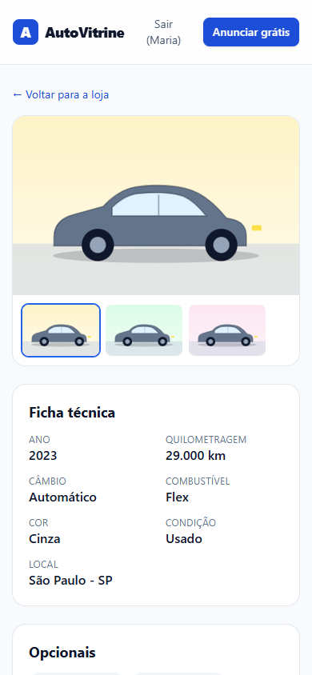
</p>

## Como rodar

Requisitos: Node.js 20 ou superior.

```bash
git clone https://github.com/maxpowernet/autovitrine.git
cd autovitrine
npm install
npm run dev        # http://localhost:5173
```

| Comando | O que faz |
|---|---|
| `npm run dev` | servidor de desenvolvimento |
| `npm run build` | verifica os tipos (TypeScript) e gera a versão de produção em `dist/` |
| `npm run preview` | serve o build de produção |
| `npm test` | roda os testes (Vitest) |
| `npm run lint` | análise estática (oxlint) |

**Para testar o fluxo completo:** clique em *Anunciar grátis*, crie uma conta (qualquer dado serve), siga os 4 passos e publique. O anúncio aparece na loja e em *Meus anúncios*. Para recomeçar do zero, limpe o `localStorage` do site.

## Integração com a tabela FIPE

O serviço `src/services/fipeService.ts` usa a **[BrasilAPI](https://brasilapi.com.br/docs#tag/FIPE)** (CORS liberado, sem chave):

| Endpoint | Uso |
|---|---|
| `GET /api/fipe/marcas/v1/carros` | lista de marcas |
| `GET /api/fipe/veiculos/v1/carros/{codigoMarca}` | modelos da marca |
| `GET /api/fipe/preco/v1/{codigoFipe}` | preço por ano-modelo e mês de referência |

**Fluxo de consulta de preço:**
1. O modelo escolhido é ligado a um **código FIPE** (do catálogo local ou digitado pelo usuário).
2. O app consulta `preco/v1/{codigo}` (timeout de 6 s) e filtra pelo ano. Resultado: selo **"Tabela FIPE · {mês}"**.
3. Se a API falhar, demorar ou não tiver o ano, usa o **catálogo local** (`src/data/fipeCatalogo.ts`) e mostra **"Valor estimado (offline)"**. Para anos que faltam no catálogo, estima por depreciação de ~6% ao ano a partir do ano mais próximo.
4. Sem código nem catálogo, o anúncio segue sem referência (selo "Sem referência FIPE").

Marcas e modelos ficam em cache no `localStorage`; se a API de listas cair, o formulário usa as marcas e modelos do catálogo.

**Catálogo local:** 26 modelos populares (Onix, Tracker, Mobi, Argo, Pulse, Toro, HB20, Creta, Polo, T-Cross, Nivus, Gol, Saveiro, Corolla, Hilux, Yaris, Renegade, Compass, Kwid, Duster, Civic, HR-V, City, Kicks, C3, Dolphin) com códigos FIPE e valores da tabela de **novembro/2026**. Cada modelo representa **uma versão** (ex.: Polo 1.0 Flex 12V 5p); a BrasilAPI não informa o código FIPE de cada versão, então a referência de preço é daquela versão e a tela mostra qual é.

> Nos testes feitos em 24/11/2026 o endpoint de preço da BrasilAPI respondeu erro 500 (a própria API avisa "fonte de dados FIPE temporariamente indisponível"). Por isso as capturas de tela mostram "Valor estimado (offline)". O caminho "FIPE oficial" está coberto por testes automatizados com respostas simuladas, mas ainda não foi visto ao vivo.

## Estrutura do projeto

```
src/
  data/
    anuncios.ts         24 anúncios de exemplo (preços calculados a partir da FIPE)
    fipeCatalogo.ts     catálogo de reserva: códigos e valores FIPE
    constantes.ts       UFs, cores, câmbios, combustíveis
  services/
    fipeService.ts      BrasilAPI + cache + reserva local (e fipeService.test.ts)
    store.tsx           anúncios, usuários e sessão (Context + localStorage)
  lib/
    pricing.ts          comparaPreco: abaixo / na média / acima
    filters.ts          busca, filtros e ordenação
    format.ts           moeda e km em pt-BR
    imagem.ts           reduz fotos antes de salvar
    placeholder.ts      ilustração de carro (SVG) dos anúncios de exemplo
  components/           Header, CarCard, FilterSidebar, FipeBadge
  pages/                Loja, Detalhe, Anunciar, Entrar, MeusAnuncios
  types.ts              Anuncio, Usuario, Filtros
```

**Stack:** Vite, React 19, TypeScript, Tailwind CSS v4, React Router, Vitest.

**Rotas:** `/` (loja) · `/anuncio/:id` · `/anunciar` · `/entrar` · `/meus-anuncios`

## Regras de negócio
- **Faixa de preço vs FIPE:** abaixo se o preço pedido for **mais de 5% menor** que a FIPE; acima se for **mais de 5% maior**; na média nos demais casos. O limite fica em `src/lib/pricing.ts`.
- **Veículo novo:** km fixo em 0 e anos limitados aos dois mais recentes.
- **Anúncios pausados** não aparecem na loja, só em *Meus anúncios*.
- **Contato:** o botão de WhatsApp abre `wa.me` com uma mensagem pronta para o vendedor.

## Testes

```bash
npm test
```

20 testes cobrem a comparação de preço, filtros/busca/ordenação e o `fipeService` (resposta da BrasilAPI, queda da API com uso do catálogo, modelo desconhecido, código FIPE informado manualmente e estimativa por depreciação).

## Limitações conhecidas
- **Sem backend:** os dados existem só no navegador de quem cadastrou; outro navegador não vê os anúncios criados.
- **Login de demonstração:** identifica o usuário só pelo e-mail, sem senha.
- **Armazenamento:** as fotos são salvas como imagem no `localStorage` (limite de alguns MB). Se estourar, o app avisa para remover fotos.
- **Catálogo FIPE pequeno:** 26 modelos; os demais dependem da BrasilAPI e do código FIPE informado.
- **Fotos de exemplo** são ilustrações geradas, não fotos reais.

## Próximos passos
- Backend e banco de dados (usuários com senha, anúncios compartilhados entre navegadores).
- Armazenamento de imagens em nuvem.
- Código FIPE por versão do veículo.
- Favoritos, comparação entre anúncios e mensagens entre comprador e vendedor.
